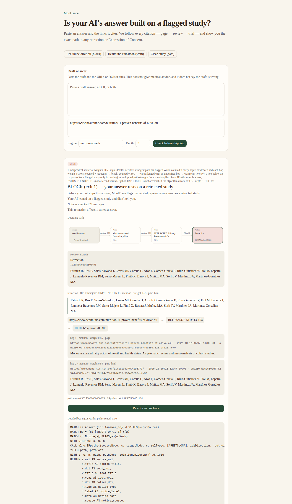
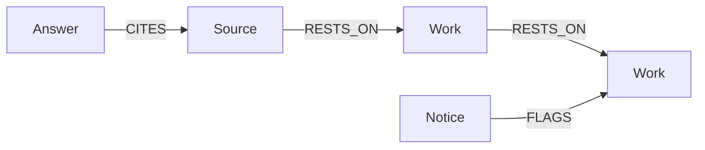
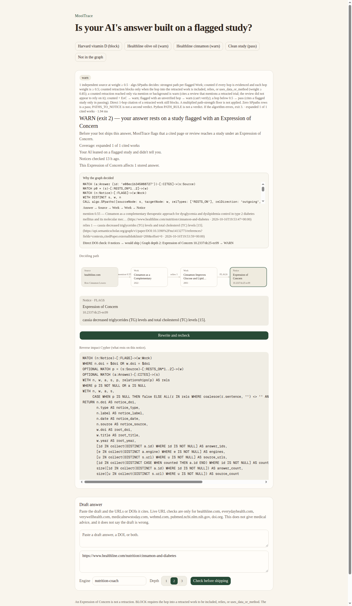

# MoolTrace

MoolTrace catches when your health AI's sources quietly rest on a flagged or retracted study, even three links deep.

**Live demo (no sign-up):** https://mooltrace.h9g8gwz2b559t.ap-south-1.cs.amazonlightsail.com/ — click **Healthline olive oil (block)**.

WeMakeDevs × FalkorDB Graph Hacks, Track 01: **Agents That Act on Connected Data**.



Signed-out headless Chrome 1280×2200 capture, 16 Oct 2026, of `https://mooltrace.h9g8gwz2b559t.ap-south-1.cs.amazonlightsail.com/?preset=olive-oil`. BLOCK (exit 1). Page `mention` 0.55 → Schwingshackl 2014 `mention` 0.55 → Estruch 2013 retraction `10.1056/nejmc1806491` (2018-06-13). `Decided by: algo.SPpaths, path strength 0.30`. Both hops are mention; the 2013 trial was retracted and republished in 2018 after re-analysis. This does not say olive oil or the Mediterranean diet works or does not.

```bash
python3 -m venv .venv && .venv/bin/pip install -e .
export MOOLTRACE_MAILTO=you@example.com
.venv/bin/python -m mooltrace check --url https://www.healthline.com/nutrition/cinnamon-and-diabetes --summary
```

Expect **WARN (exit 2)** on that cinnamon URL (Expression of Concern, not a retraction). The live demo BLOCK above is the olive-oil path. Timed from a fresh clone in `/tmp` on 16 Oct 2026: quickstart **65.06 s** (clone 3.02 s + `pip install -e .` 9.67 s + cinnamon `--summary` 52.37 s, exit 2). Earlier same-day cold `--summary` repeats were 47.09 s / 49.18 s / 49.10 s (see **Honest results** and [CLAIMS.md](CLAIMS.md)). Five-minute path: [JUDGES.md](JUDGES.md).

**Who it is for:** teams shipping health AI — symptom checkers, nutrition coaches, patient chatbots. Paste an answer and the pages it cites. MoolTrace follows page → review → trial in FalkorDB and returns pass / warn / block before you ship. It reports a path to a publisher notice. It does not say the draft is medically correct or incorrect. **Pass is not a medical-accuracy check.**

## Decision

| Verdict | Exit | What it means | What to do |
| --- | --- | --- | --- |
| pass | 0 | No counted or unverified path to a publisher notice within this depth. **Pass is not a medical-accuracy check.** | Ship the fixture. Coverage is not shown beyond the depth cap. |
| warn: concern | 2 | A counted path reaches an Expression of Concern. | Human review. Disclose or replace the source. `mooltrace rewrite` fixes only the affected sentence. |
| warn: can't verify | 2 | A reachable path is unverified, a cited DOI could not be resolved, the check did not finish, or no verifiable source was provided (`no_sources`). | Do not treat this as a pass. Add a source or retry. |
| block | 1 | A counted path reaches a retraction, withdrawal, or removal. | Fail the build. Disclose or replace the source. |
| error | 3 | Graph timeout or exhausted upstream. | Retry later. Not a silent pass and not a block. |

A **counted path** is the strongest `algo.SPpaths` route from the answer to a flagged Work (depth ≤ 3) whose every hop has a stored sentence and a `RESTS_ON` weight ≥ 0.5. Path strength is still the product of those weights (`exp(−Σ −ln(w))`); a multiplied floor is not applied, so a confirmed retraction or Expression of Concern in a counted or unverified chain at least warns. Counted + retraction → **block**. Counted + Expression of Concern → **warn**. Flagged but an unverified hop → **warn** (can't verify). A hop below 0.5 → **pass** with "cites a flagged study only in passing". `--summary` and the UI print `Decided by: algo.SPpaths, path strength 0.55` plus the Cypher. If `algo.SPpaths` errors, the check returns exit 3, not a verdict. Unweighted `shortestPath` is not the verdict. Unverified hops warn; they never silently pass. The draft cannot hedge-bypass: naming an Expression of Concern or writing "we excluded" in the pasted answer does not turn a cited flagged study into a pass. A scholarly review can still set a study aside. Depth is 1–3. Depth 4 is not implemented. `pass` means no counted or unverified notice was found within that depth. Coverage is **not shown** beyond it. Seeds past the expand cap are still notice-checked.

Notices come from Crossref. Citation lists come from OpenAlex. Diabetes Care `care/article/{volume}/{issue}/{page}` URLs resolve through Crossref on the ADA DOI pattern, then OpenAlex. Citation sentences come from Semantic Scholar contexts, PMC, the citing page, or the pasted draft.

## Graph model



Nodes: `Answer`, `Source`, `Work`, `Notice`.

Edges: `(Answer)-[:CITES]->(Source)`, `(Source)-[:RESTS_ON]->(Work)`, `(Work)-[:RESTS_ON]->(Work)`, `(Notice)-[:FLAGS]->(Work)`.

`RESTS_ON` stores `reliance`, `weight`, `cost`, `sentence`, `evidence_from`, `judged`, `judged_at`, plus the hop evidence trail (`evidence_url`, `evidence_fetched_at`, `evidence_sha256`). `cost` is `-ln(weight)` for `algo.SPpaths`.

Every path from a cited source (used for traces and brute-force equality tests; not the verdict). Zero `algo.SPpaths` rows is a pass on this listing: it never supplies a second warn or block. Bounds are literals; depth 2 shown. `FLAGS` is matched separately so FalkorDB does not bind the notice hop into `p`:

```cypher
MATCH (a:Answer {id: $answer_id})-[:CITES]->(s:Source)
MATCH p = (s)-[:RESTS_ON*1..2]->(w)
MATCH (n:Notice)-[:FLAGS]->(w:Work)
WITH s, w, n, p, relationships(p) AS rels
WITH s, w, n, p, rels,
     reduce(score = 1.0, r IN rels | score * coalesce(r.weight, 0.0)) AS path_score
RETURN s.url AS source_url,
       s.title AS source_title,
       w.doi AS root_doi,
       w.title AS root_title,
       w.year AS root_year,
       n.doi AS notice_doi,
       n.type AS notice_type,
       n.label AS notice_label,
       n.date AS notice_date,
       n.source AS notice_source,
       length(p) AS hops,
       path_score,
       [x IN nodes(p) | {doi: x.doi, title: x.title, url: x.url, year: x.year}] AS steps,
       [r IN rels | {weight: r.weight, reliance: r.reliance, sentence: r.sentence, evidence_from: r.evidence_from, judged: r.judged, source_url: r.evidence_url, fetched_at: r.evidence_fetched_at, content_hash: r.evidence_sha256}] AS hops_evidence
ORDER BY path_score DESC, hops ASC
LIMIT 80
```

The deciding query is `algo.SPpaths` (bounds are literals; depth 2 shown):

```cypher
MATCH (a:Answer {id: $answer_id})-[:CITES]->(s:Source)
MATCH p0 = (s)-[:RESTS_ON*1..2]->(w)
MATCH (n:Notice)-[:FLAGS]->(w:Work)
WITH DISTINCT s, w, n
CALL algo.SPpaths({sourceNode: s, targetNode: w, relTypes: ['RESTS_ON'], relDirection: 'outgoing', maxLen: 2, weightProp: 'cost'})
YIELD path, pathCost
```

`cost` on `RESTS_ON` is `-ln(weight)`. Lower cost is stronger reliance.

Algorithms this product actually runs:

| Algorithm | Job |
| --- | --- |
| `algo.SPpaths` | Verdict. Strongest `RESTS_ON` path to a flagged Work, cost `-ln(weight)`. If it errors, exit 3. |
| `algo.WCC` | Remediation clusters only (not the verdict). Groups answers that share a Work component containing a publisher notice. |

`algo.pageRank` is registered in FalkorDBLite 0.10.0 and is **not** called. It does not change what a check shows. `algo.MaxFlow` is not registered in this build. Independent sources are distinct citers on counted paths.

Remediation clusters use:

```cypher
CALL algo.WCC({nodeLabels: ['Work'], relationshipTypes: ['RESTS_ON']})
YIELD node, componentId
```

The fixture batch report includes these clusters.

## CI

`mooltrace check` is an alias of `check-answer`. TTY prints the 3-line verdict. `--json` prints the full payload. Non-TTY defaults to JSON.

`--fail-on block` (default) fails CI on block and infra. Warn is annotated (`::warning`) and does not fail. Use `--fail-on warn` to fail on warn too. `examples/answers.jsonl` is the CI sample (Everyday Health URL-only + Allen 2013). Those warn; they do not block. `--fail-on block` therefore exits 0. `examples/lancet.jsonl` is the retraction demo and exits 1.

GitHub Action (same as `.github/workflows/mooltrace-fixtures.yml`). This is a sample workflow, not a reusable action. The daily schedule is a fresh fixture recheck, not persistent monitoring:

```yaml
jobs:
  check:
    runs-on: ubuntu-latest
    steps:
      - uses: actions/checkout@3d3c42e5aac5ba805825da76410c181273ba90b1
      - run: |
          python3 -m venv .venv
          .venv/bin/pip install -e .
          .venv/bin/python -m mooltrace batch examples/answers.jsonl --fail-on block
```

## MCP

**Remote MCP** (read-only, no sign-up): `https://mooltrace.h9g8gwz2b559t.ap-south-1.cs.amazonlightsail.com/mcp` — streamable HTTP. Tools: `check_answer`, `what_rests_on`, `recheck_affected`. Same three presets as the demo; presets never 429. Copy-paste for Cursor or Claude Desktop (`mcp.http.example.json`):

```json
{
  "mcpServers": {
    "mooltrace": {
      "url": "https://mooltrace.h9g8gwz2b559t.ap-south-1.cs.amazonlightsail.com/mcp"
    }
  }
}
```

Claude Desktop can add `"type": "http"` next to `url`.

**Local MCP** (one command, full tool list). After the venv above: `.venv/bin/python -m mooltrace mcp`. Point Cursor/Claude at `mcp.example.json`:

```json
{
  "mcpServers": {
    "mooltrace": {
      "command": "/absolute/path/to/MoolTrace/.venv/bin/python",
      "args": ["-m", "mooltrace.mcp_server"],
      "env": {
        "MOOLTRACE_DB": "/absolute/path/to/MoolTrace/data/mooltrace.db",
        "MOOLTRACE_MAILTO": "you@example.com"
      }
    }
  }
}
```

The web UI is an evidence viewer for the demo, not the core claim. MCP is an editor integration for the same check.

## Baseline

Numbers from `results/baseline_2026-10-16.md` / `results/baseline_2026-10-16.json` (16 Oct 2026). A no-graph checker looks up **only DOIs and doi.org URLs written in the draft** on Crossref `updated-by`. It does not fetch consumer pages and does not walk `RESTS_ON`. Binary positive class is `warn` or `block`. Infra rows: 0. Labelled file: `examples/labelled.jsonl` (52 cases). Crossref catalog fetched 2026-10-16T15:31:06+00:00. MoolTrace labelled run 2026-10-16T15:39:56+00:00, 486.0 s, isolated throwaway graphs, `MOOLTRACE_DB` unused. This is not a medical accuracy score and not a random sample.

Reproduce (offline; recorded Crossref + recorded MoolTrace labelled run):

```bash
.venv/bin/python -m mooltrace baseline --out results/baseline_2026-10-16.json
```

| Checker | Precision | Recall | F1 | Exact 3-way | TP / FP / FN / TN |
| --- | --- | --- | --- | --- | --- |
| Direct-DOI (no graph) | 1.0 | 0.4286 | 0.6 | 0.6154 (32/52) | 15 / 0 / 20 / 17 |
| MoolTrace (`algo.SPpaths`) | 0.8974 | 1.0 | 0.9459 | 0.9231 (48/52) | 35 / 4 / 0 / 13 |

15 cases only multi-hop catches (MoolTrace warn, direct-DOI pass): `eoc-everyday-health-url`, `eoc-allen-2013`, `eoc-deyno-2019`, `eoc-ctim-2020`, `eoc-moridpour-2023`, `eoc-cochrane-2012`, `eoc-everyday-health-draft`, `hedged-everyday-eoc`, `hedged-allen-eoc`, `page-healthline-cinnamon`, `page-healthline-hedged`, `page-healthline-draft`, `i18n-hi-healthline`, `page-everyday-health-cinnamon`, `page-healthline-utm`.

Four labelled-pass disagreements (why precision is 0.8974, not 1.0): WebMD cinnamon **block** (R5 relabel candidate), MNT **warn**, NCCIH **warn** (unverified), MDPI `/pdf` **warn** (HTTP 403, incomplete). Did not relabel. Labelling rule (written 16 Oct 2026, before the 16 Oct rows were run) is in `examples/labelled.jsonl` and `results/baseline_2026-10-16.md`.

## Limits

- This does not give medical advice and does not say cinnamon, olive oil, hydroxychloroquine, or any intervention works.
- Khan 2003 (`10.2337/diacare.26.12.3215`) carries Expression of Concern `10.2337/dc25-ec09` (2025-08-20), not a retraction. OpenAlex `is_retracted` can stay false.
- Mehra et al., Lancet 2020 (`10.1016/s0140-6736(20)31180-6`) was retracted (`10.1016/s0140-6736(20)31324-6`).
- Estruch 2013 PREDIMED (`10.1056/nejmoa1200303`) was retracted and republished in 2018 (`10.1056/nejmc1806491`). The olive-oil BLOCK is a path to that retracted 2013 version.
- Cleveland Clinic pages are not fetched in shipped presets or tests.
- Everyday Health `/diabetes/cinnamon-for-diabetes/` is a public article URL (no login). The demo fetches it once to walk page → review → study → publisher notice. It is not a training crawl. Named AI crawlers are blocked in that site's robots.txt; this User-Agent identifies MoolTrace with a mailto. If that fetch is refused, use Allen 2013 as the DOI fixture.
- Unverified or unfinished reachable paths warn. They never silently pass.
- A draft with no DOI, PMID, PMCID, resolvable scholarly identifier, or public URL warns (`no_sources`). MoolTrace cannot inspect that evidence chain. This is not a pass and not a medical claim. Inline DOI, PMID, PMCID, or URL, and explicit URLs, still count as sources.
- Private, loopback, credentialed, and non-http URLs are refused (SSRF). The API binds `127.0.0.1` and does not honor CORS `*`.
- Semantic Scholar 429s after retries skip that route; other sentence routes still run.
- The sample GitHub workflow fetches live OpenAlex, Crossref, and the Everyday Health page. If a host refuses GitHub IPs, the job exits 3. The daily cron re-runs that fixture file; it does not watch answers over time.
- Hosted demo free-text is presets-only (`MOOLTRACE_PUBLIC_DEMO=1`). Oversized drafts return 413.
- Rewrite is a deterministic template: only sentences that cite flagged work change; every other sentence stays byte-identical. Named as first author + year. Never writes `RETRACTED:` and never cites the notice DOI.

## Prior art

Facts only. Each claim was read from that project's public repo or docs on 16 Oct 2026. This is not a claim of unique multi-hop, unique MCP, or continuous monitoring.

[Shaky Ground](https://github.com/aryangorde6/shaky-ground) traces papers that *build on* retracted work through reliance-weighted citation chains, with hop sentences stored on the edges. It ships stdio MCP (`check_foundations`, `retraction_blast_radius`, `explain_chain`) and a web UI. Their [`docs/DEPLOY.md`](https://github.com/aryangorde6/shaky-ground/blob/main/docs/DEPLOY.md) documents a public demo at https://shaky-ground-production.up.railway.app (`ALLOW_RUNS=0`). A signed-out HEAD of that URL on 16 Oct 2026 17:40 UTC returned HTTP 501. Input is a paper DOI, OpenAlex ID, or PMID — not a health-AI answer or a consumer page. Expression of Concern rows are dropped: [`shaky/retractionwatch.py`](https://github.com/aryangorde6/shaky-ground/blob/main/shaky/retractionwatch.py) keeps only notices where `RetractionNature == "Retraction"` (line 61 as fetched 16 Oct 2026).

[scite](https://scite.ai/features) Reference Check evaluates the references in a manuscript PDF and flags cited papers that were retracted or received an [expression of concern or other editorial notice](https://scite.ai/blog/reference-check-an-easy-way-to-check-the-reliability-of-your-references-b2afcd64abc6). It does not walk a consumer page → review → trial chain.

[GhostCite](https://github.com/musharna/ghostcite) is a deterministic CLI that checks author/year against the Crossref record for each cited DOI and flags retracted or expression-of-concern works on that DOI. It does not hop through reviews.

[Bedrock](https://github.com/ibnweb3/bedrock) takes a DOI bibliography, traces retracted works (directly or one intermediate paper), and **proposes (never auto-applies) edits**. Their README also lists PageRank among graph algorithms run inside FalkorDB. Status on 16 Oct 2026: data pipeline and backtest exist; "Not built yet: the agent loop, the approval step and the UI."

What MoolTrace adds on that ground, each tied to something those repos do not do:

- **Expression of Concern as warn**, not dropped. Khan 2003 `10.2337/dc25-ec09` is an EoC, not a retraction.
- **AI-answer text + consumer page URL** as input, so a Healthline page with no DOI in the draft still reaches the notice.
- **Rewrite of only the flagged sentence**, then a graph recheck (`rewrite_answer`). Other sentences stay byte-identical.
- **CI exit codes** pass 0 / warn 2 / block 1 / error 3 as a pre-ship gate (`mooltrace batch`).
- **MCP** `what_rests_on` and `recheck_affected` after a new notice lands.

## Demo

```bash
docker compose up --build
```

Open [http://127.0.0.1:4318](http://127.0.0.1:4318). API health is [http://127.0.0.1:4317/health](http://127.0.0.1:4317/health). Compose publishes those ports on loopback only. Three presets from recorded live runs on 16 Oct 2026: **Healthline olive oil** (URL-only counted 2-hop, page `mention` 0.55 → Schwingshackl 2014 `mention` 0.55 → Estruch 2013 retraction `10.1056/nejmc1806491` 2018-06-13, `Decided by: algo.SPpaths, path strength 0.30`, block), **Healthline cinnamon** (URL-only counted 2-hop, page → Silva 2022 `relies` 1.0 → Khan Expression of Concern, path strength 0.55, warn), and a clean DOI (pass at depth 2). Both olive-oil hops are `mention`; do not read that as the review relying on the trial. The 2013 trial was retracted and republished in 2018 after re-analysis. Expression of Concern is not a retraction. First boot seeds those three into `/data/demo.db` (a Compose volume, not `data/mooltrace.db`). After a warn or block, **Rewrite and recheck** drops the flagged citations. The Cypher panel shows `algo.SPpaths`. No copyrighted full text. This does not say olive oil, cinnamon, or the Mediterranean diet works or does not. Private, loopback, and credentialed URLs stay refused. Public HTTPS: https://mooltrace.h9g8gwz2b559t.ap-south-1.cs.amazonlightsail.com/ (Lightsail micro, ap-south-1; teardown in `SHIP_CHECKLIST.md`).



Headless Chrome 1280×900 capture, 16 Oct 2026. The PNG is a synthetic example rendered from demo-UI copy (it still prints path strength 0.72; not a running Next server).

Recorded Healthline replay (page fetched 16 Oct 2026 13:43 UTC; Silva→Khan hop judged 15 Oct 2026 from Europe PMC XML): page → Silva 2022 → Khan 2003 Expression of Concern. `Decided by: algo.SPpaths, path strength 0.55`. The review→trial hop class is `relies`. Re-capture from `http://127.0.0.1:4318/?preset=healthline` on video day if you want the live DOM.

Example `--summary` from a cold Healthline check on 16 Oct 2026:

```
WARN (exit 2) — your answer rests on a study flagged with an Expression of Concern
healthline.com/nutrition/cinnamon-and-diabetes → Cinnamon as a Complementary Therapeutic Appro… (2022) (10.3390/nu14132773) → Cinnamon Improves Glucose and Lipids of Peopl… (2003) (10.2337/diacare.26.12.3215)
Flag: Expression of Concern 10.2337/dc25-ec09 (2025-08-20) · notices checked 25 s ago
What to do: disclose or replace this source. Run `mooltrace rewrite` to fix only the affected sentence.
```

Python 3.12+. Node 20+ only for the demo UI. One venv. Local UI without Compose: `cd web && npm ci && npm run dev -- --port 4318 --hostname 127.0.0.1` with `.venv/bin/python -m mooltrace.api` on 4317. `/nw/*` rewrites to the API.

## Use from an AI agent

MoolTrace is a pre-ship check, not a medical model. The agent drafts. MoolTrace says whether a cited page or paper reaches a publisher notice. On warn or block, `rewrite_answer` rewrites only the affected sentences and rechecks. The rewrite is a deterministic template: it discloses the publisher notice or an on-topic sibling already in this answer's graph. It never invents a citation. Code strips flagged URLs and DOIs. Every unflagged sentence stays byte-identical.

**CI (the usual team path).** Put each bot answer in JSONL (`id`, `engine`, `text`, `urls`). On every pull request:

```bash
.venv/bin/python -m mooltrace batch examples/answers.jsonl --fail-on block
```

Exit **1** fails the job (retraction path). Exit **2** with `--fail-on block` still passes; GitHub prints `::warning` so the reviewer sees the Expression of Concern. Use `--fail-on warn` if your team will not merge warned fixtures. An agent that generates answers should write that JSONL, then run the same command, then read `decision` / `reasons[].notice_doi` / `reasons[].sentence`.

**Editor MCP.** Remote: paste the `/mcp` URL above into Cursor or Claude Desktop (three read-only tools). Local: `.venv/bin/python -m mooltrace mcp` and copy `mcp.example.json`. Tools on stdio:

| Tool | When the agent calls it |
| --- | --- |
| `check_answer` | After it drafts, before it shows the user or opens a PR. Pass `text`, `urls`, `engine`, `depth` (1–3). |
| `rewrite_answer` | After warn or block. Drops flagged citations, rechecks. That is the graph-based action. |
| `trace_answer` | When it needs the hop list, not only the verdict. |
| `check_study` | When the user pasted one DOI. |
| `what_rests_on` | After a new notice lands: "This Expression of Concern affects N stored answers." |
| `recheck_affected` | Re-run `check_answer` on just those counted answers. |
| `explain_path` | Show the `algo.SPpaths` call, path strength, and hop sentences. |
| `shared_ancestors` | Before claiming two engines are independent. |
| `ro_cypher` | Read-only inspection. `CREATE` is rejected. |

Offline loop on a fixture graph (no paid LLM, no live HTTP):

```bash
.venv/bin/python examples/agent_loop.py
```

A realistic loop:

1. Collect the draft and every cited URL.
2. Call `check_answer`.
3. Exit 3: retry later. Do not ship. The catalogs or the graph timed out.
4. `block` or `warn`: call `rewrite_answer`, then read `recheck.decision`. Do not hide an Expression of Concern.
5. `pass`: no counted notice within this depth. Still not a medical claim. Coverage is not shown beyond the depth cap.
6. No DOI or URL: `no_sources` warn. The agent must ask for a source or refuse to ship.

Do not put MoolTrace inside the model's system prompt as "the truth". Call it as a tool after generation. Keep `MOOLTRACE_DB` on disk so `what_rests_on` can see prior answers. The HTTP API binds `127.0.0.1` only.

Demo hero: Healthline URL only, no Khan DOI in the pasted text. See `examples/healthline.jsonl`. CI still uses Everyday Health in `examples/answers.jsonl`.

```bash
.venv/bin/python -m mooltrace check-answer \
  --urls-file <(printf '%s\n' 'https://www.healthline.com/nutrition/cinnamon-and-diabetes') \
  --engine nutrition-coach \
  --depth 2
```

## Why a graph

Take FalkorDB out and you lose: (1) multi-hop weighted search over a shared citation graph reused across answers; (2) `algo.SPpaths` with `cost = -ln(weight)` as the verdict (every hop evidenced and weight ≥ 0.5); (3) reverse impact (`what_rests_on` / `recheck_affected`) in one Cypher query. A list of DOIs is not that. If the algorithm is disabled, the check returns exit 3.

## Glossary

| Term | Meaning |
| --- | --- |
| Expression of Concern | A publisher notice that a paper's reliability is under review. It is not a retraction. |
| retraction | The publisher withdrew the paper. A counted path to one **blocks**. |
| reliance weight | How strongly this hop uses the next work (`included` 1.0 … `background` 0.2). Stored on `RESTS_ON`. |
| citation path / hop | One `RESTS_ON` edge: page → review, or review → trial. The sentence is stored on that edge. |
| depth | Hop budget from the cited source, 1–3. Coverage is not shown beyond it. |

Reverse lookup lists every matching notice and only the answers whose sources reach that work. The Cypher `counted` flag matches the forward verdict: every hop has a stored sentence and each hop weight is ≥ 0.5. It is not a monitoring or alert scheduler.

Every query the tools run is in `mooltrace/cypher.py`.

## Reliance weights

| Class | Weight | Counts |
| --- | --- | --- |
| included | 1.0 | yes (strongest: listed among a review's included studies) |
| relies | 1.0 | yes |
| uses_data_or_method | 0.85 | yes |
| mention | 0.55 | yes (0.55 ≥ 0.5). The olive-oil BLOCK is mention × mention. |
| background | 0.2 | no |
| critical | 0.0 | no |

`included` is detected from PMC full-text XML (Europe PMC `fullTextXML` / PMC OA): characteristics-of-included-studies tables, risk-of-bias tables, forest-plot or study lists, PRISMA "were included" prose, and reference-list sections labelled included. Study labels map to a reference DOI by author surname **and** year or reference id, not surname alone. The stored sentence looks like `Listed among included studies (Table 1: Characteristics of included studies)` plus the PMC article URL. A flattened table header is never stored as the hop sentence. This does not say the review is wrong: it records that the review included a trial that was later retracted.

Semantic Scholar [citation context data](https://www.semanticscholar.org/) may appear in hop evidence (`evidence_from: semantic_scholar`). Intent labels from that API are not requested.

## Seeded regression (not accuracy)

`python -m mooltrace.gate` runs each fixture on its **own throwaway graph** at default depth 2. It never deletes `MOOLTRACE_DB`.

Positives: Everyday Health URL-only, Allen 2013, Deyno 2019 (`10.1016/j.diabres.2019.107815`, not Namazi), CTIM 2020, Moridpour 2023 (`10.1002/ptr.8026`, first author Moridpour), Cochrane 2012, Lancet 2020 retraction.

Clean DOIs are works that had no Crossref retraction / withdrawal / removal / EoC on the work itself **and** no flagged ancestor within depth 2 on an isolated graph as of 15 Oct 2026. They are not a random sample. Papers that merely sit near Khan (for example `10.1093/jn/136.4.977`) are true signals, not clean negatives. Any warn/block on a clean fixture is an **alarm**.

Live numbers are not hardcoded. Run the gate. Files under `results/` are marked stale and are not a score.

## Labelled set

`examples/labelled.jsonl` is 52 health-AI drafts with expected `pass` / `warn` / `block`: Expression of Concern, retraction, hedged wording, clean DOIs, `no_sources`, depth-1 coverage, real health-page hops (Healthline, Everyday Health, WebMD, Medical News Today; VerywellHealth returned HTTP 403 on 16 Oct 2026 so it is not in the set), fake/preprint/dataset identifiers, and non-English drafts. Each case uses its own throwaway graph. New rows were labelled on 16 Oct 2026 by Siddhant Vishnu from the rule block at the top of that file **before** the runner. Caught = warn or block. An Expression of Concern is not a retraction.

```bash
.venv/bin/python -m mooltrace labelled
```

The report prints precision and recall on a binary flagged class (`warn` or `block`), exact three-way match, and wall / query timing. Infra rows are excluded from scored metrics. This is not a random sample and not a medical accuracy score. pytest checks the schema only. It does not call live catalogs. Dated scores are in **Baseline** (`results/baseline_2026-10-16.md`).

## Honest results

Numbers below are from this checkout on 16 Oct 2026. Re-run the command next to each line. Do not treat them as a medical accuracy score.

| Claim | Command | Result (16 Oct 2026) |
| --- | --- | --- |
| Full unit suite | `unshare --net --map-root-user .venv/bin/python -m pytest -q` | 16 Oct 2026 this checkout: 253 passed, 0 failed, 384.47 s, network namespace unshared |
| Flip + ablation | `.venv/bin/python -m pytest tests/test_graph.py::test_sp_weight_flip_changes_verdict tests/test_graph.py::test_sp_paths_ablation_returns_exit_3 tests/test_graph.py::test_sp_paths_strength_equals_brute_force_product -q` | 16 Oct 2026: weight 0.85 → warn, 0.2 → pass; `sp_paths` raised → exit 3, no verdict; algorithm strength equals brute-force product on 3 fixtures. |
| Agent loop | `.venv/bin/python examples/agent_loop.py` | check warn, `algo.SPpaths`, rewrite recheck pass, 1 counted answer |
| Fresh-clone quickstart in `/tmp` | `git clone … && python3 -m venv .venv && .venv/bin/pip install -e . && .venv/bin/python -m mooltrace check --url https://www.healthline.com/nutrition/cinnamon-and-diabetes --summary` | 16 Oct 2026: **65.06 s** (clone 3.02 s + install 9.67 s + check 52.37 s). WARN exit 2, EoC `10.2337/dc25-ec09`, `algo.SPpaths` 0.55. See [CLAIMS.md](CLAIMS.md). |
| Cold Healthline `--summary` | `MOOLTRACE_HTTP_CACHE=/tmp/mt-cold MOOLTRACE_DB=/tmp/mt-cold/mooltrace.db .venv/bin/python -m mooltrace check --url https://www.healthline.com/nutrition/cinnamon-and-diabetes --summary` | 47.09 s / 49.18 s / 49.10 s. All three: warn, EoC `10.2337/dc25-ec09`. No verdict flip. ~119–121 API calls cold. |
| Warm Healthline (same DB+cache) | same command again | 23.16 s, 26 API calls, still warn / same EoC |
| Gate (cold cache) | `.venv/bin/python -m mooltrace.gate` | not re-run in this session; T02 dated files under `results/gate_2026-10-16*` |
| Labelled vs no-graph baseline (52 cases) | `.venv/bin/python -m mooltrace baseline --out results/baseline_2026-10-16.json` | See **Baseline**: MoolTrace precision 0.8974 recall 1.0 exact 48/52; direct-DOI precision 1.0 recall 0.4286 exact 32/52; 15 only-multi-hop catches. |

## AI-use disclosure

MoolTrace code in this repository was written with Cursor agents (including Grok) after the Graph Hacks kickoff on 15 Oct 2026. Paths and notices come from live OpenAlex, Crossref, NCBI, Semantic Scholar, and PMC, not from the model. Rewrite is a deterministic template; it is not an LLM edit. Each teammate must be able to explain the code they ship.

## Demo checklist

1. Fresh clone, venv, `pip install -e . pytest`, `pytest`.
2. `python -m mooltrace batch examples/answers.jsonl --fail-on block` (exit 0; warns are annotated).
3. URL-only Healthline `--summary` twice on the same DB. 16 Oct 2026: cold 47–49 s (~119–121 API calls), warm 23 s (26 API calls), still warn. Do not claim zero API calls on the warm path.
4. `python -m mooltrace batch examples/lancet.jsonl --fail-on block` (exit 1) → block on the retraction notice, not the earlier EoC.
5. UI presets are Healthline olive oil (block, path strength 0.30), Healthline cinnamon (warn, path strength 0.55), and the clean DOI. The Cypher panel shows `algo.SPpaths`. Rewrite and recheck on a warn.
6. `ro_cypher` with `CONTAINS 'set'` is allowed; `CREATE` is rejected; GRAPH.RO_QUERY is the write barrier.
7. Public repo, 2:50 video, Track 01 **Agents That Act on Connected Data**, AWS/FalkorDB shown, AI tools listed.
8. `python -m pytest tests/test_labelled.py` (schema). Optional live: `python -m mooltrace labelled --limit 2`.
9. Submission drafts: `SUBMISSION.md`, `VIDEO_SCRIPT.md`, `SHIP_CHECKLIST.md`. Video and public-repo flip are not done in this checkout.

License: MIT. Copyright holder matches the GitHub profile name for `SidTheKid-dotcom` (Siddhant Vishnu).
